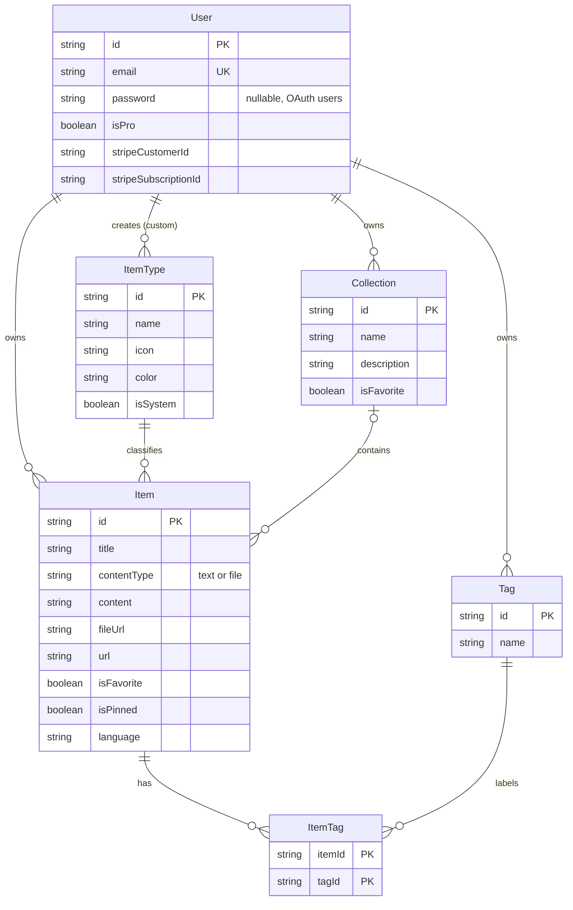
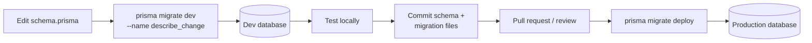
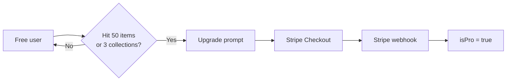
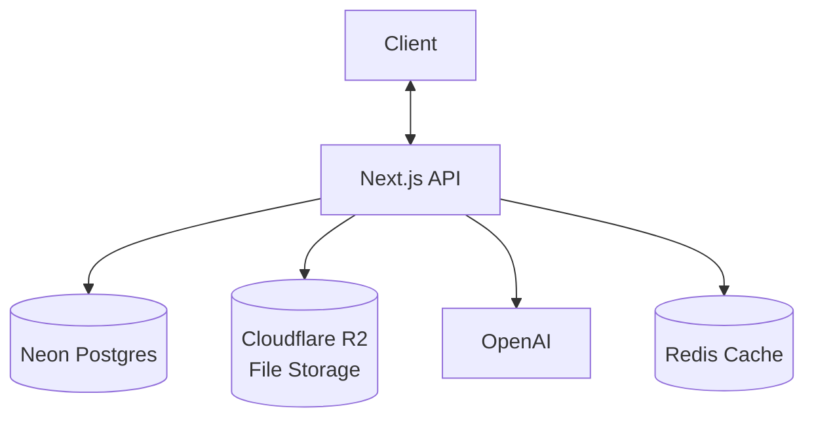
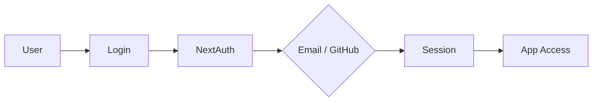
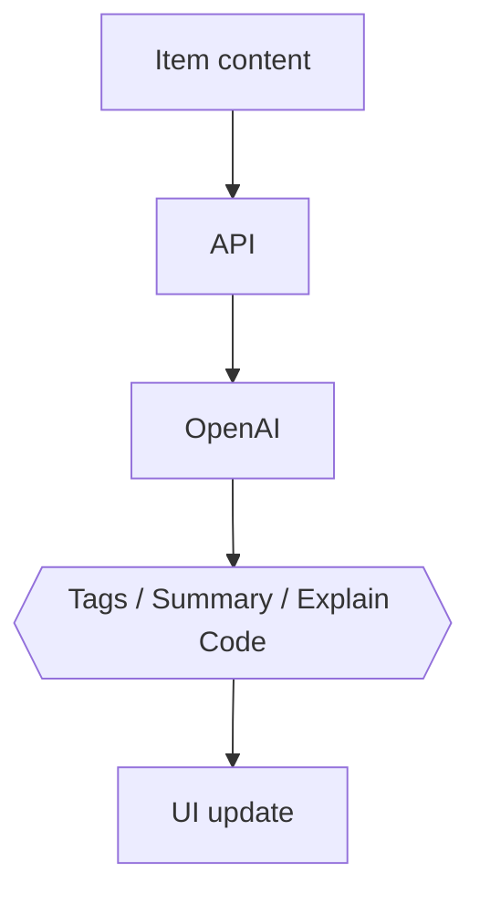
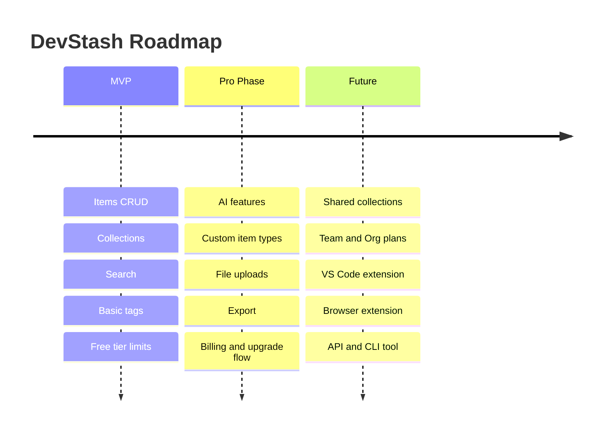

# 🚀 DevStash

> **Store Smarter. Build Faster.**
> A centralized, searchable, AI-enhanced hub for code snippets, prompts, docs, commands and more.


---

## 📑 Table of Contents

1. [Problem](#-problem)
2. [Users](#-users)
3. [Core Features](#-core-features)
4. [Data Model](#-data-model)
5. [Database Migrations](#-database-migrations)
6. [Tech Stack](#-tech-stack)
7. [Monetization](#-monetization)
8. [UI / UX](#-ui--ux)
9. [Architecture](#-architecture)
10. [Development Workflow](#-development-workflow)
11. [Roadmap](#-roadmap)
12. [Open Questions](#-open-questions)
13. [Status](#-status)

---

## 📌 Problem

Developers keep their essentials scattered across many places:

| Where it lives         | What gets lost                  |
| ---------------------- | ------------------------------- |
| 💻 VS Code or Notion   | Code snippets                   |
| 💬 Chat history        | AI prompts                      |
| 📂 Buried project dirs | Context files                   |
| 🔖 Browser bookmarks   | Useful links                    |
| 🗃️ Random folders      | Docs                            |
| 📝 `.txt` files        | Commands                        |
| 🐙 GitHub gists        | Project templates               |
| ⌨️ Bash history        | Terminal commands               |

This creates **context switching**, **lost knowledge** and **inconsistent workflows**.

➡️ **DevStash provides ONE searchable, AI-enhanced hub for all dev knowledge and resources.**

---

## 🧑‍💻 Users

| Persona                         | Needs                                     |
| ------------------------------- | ----------------------------------------- |
| 🛠️ Everyday Developer           | Quick access to snippets, commands, links |
| 🤖 AI-First Developer           | Store prompts, workflows, contexts        |
| 🎓 Content Creator / Educator   | Save course notes, reusable code          |
| 🏗️ Full-Stack Builder           | Patterns, boilerplates, API references    |

---

## ✨ Core Features

### A) Items and System Item Types

Every item belongs to one built-in type. Pro users can add custom types.

| Icon | Type    | Content kind |
| ---- | ------- | ------------ |
| 🧩   | Snippet | Text         |
| 💡   | Prompt  | Text         |
| 📝   | Note    | Text         |
| ⌨️   | Command | Text         |
| 📄   | File    | File upload  |
| 🖼️   | Image   | File upload  |
| 🔗   | URL     | Link         |

### B) Collections 📚

Organize items into collections. Mixed item types are allowed.

Examples: `React Patterns`, `Context Files`, `Python Snippets`

### C) Search 🔍

Full-text search across:

- Content
- Tags
- Titles
- Types

### D) Authentication 🔐

- Email + Password
- GitHub OAuth

### E) Additional Features

- ⭐ Favorites and pinned items
- 🕐 Recently used
- 📥 Import from files
- ✍️ Markdown editor for text items
- ☁️ File uploads (images, docs, templates)
- 📤 Export (JSON / ZIP)
- 🌙 Dark mode (default)

### F) AI Superpowers 🤖

| Feature             | What it does                           |
| ------------------- | -------------------------------------- |
| 🏷️ Auto-tagging     | Suggests tags from item content        |
| 📋 AI summaries     | Short summaries of longer items        |
| 🧠 Explain Code     | Plain-English explanation of snippets  |
| ✨ Prompt optimization | Improves stored prompts              |

> Powered by **OpenAI `gpt-5-nano`**

---

## 🗄️ Data Model

> This schema is a starting point and **will evolve**.

### Entity Relationship Diagram



### Prisma Schema (draft)

```prisma
model User {
  id                   String       @id @default(cuid())
  email                String       @unique
  password             String?
  isPro                Boolean      @default(false)
  stripeCustomerId     String?
  stripeSubscriptionId String?
  items                Item[]
  itemTypes            ItemType[]
  collections          Collection[]
  tags                 Tag[]
  createdAt            DateTime     @default(now())
  updatedAt            DateTime     @updatedAt
}

model Item {
  id          String   @id @default(cuid())
  title       String
  contentType String   // text | file
  content     String?  // used for text types
  fileUrl     String?
  fileName    String?
  fileSize    Int?
  url         String?
  description String?
  isFavorite  Boolean  @default(false)
  isPinned    Boolean  @default(false)
  language    String?

  userId      String
  user        User     @relation(fields: [userId], references: [id])

  typeId      String
  type        ItemType @relation(fields: [typeId], references: [id])

  collectionId String?
  collection   Collection? @relation(fields: [collectionId], references: [id])

  tags        ItemTag[]

  createdAt   DateTime @default(now())
  updatedAt   DateTime @updatedAt
}

model ItemType {
  id       String  @id @default(cuid())
  name     String
  icon     String?
  color    String?
  isSystem Boolean @default(false)

  userId   String?
  user     User?   @relation(fields: [userId], references: [id])

  items    Item[]
}

model Collection {
  id          String   @id @default(cuid())
  name        String
  description String?
  isFavorite  Boolean  @default(false)

  userId      String
  user        User     @relation(fields: [userId], references: [id])

  items       Item[]
  createdAt   DateTime @default(now())
  updatedAt   DateTime @updatedAt
}

model Tag {
  id     String    @id @default(cuid())
  name   String
  userId String
  user   User      @relation(fields: [userId], references: [id])

  items  ItemTag[]
}

model ItemTag {
  itemId String
  tagId  String

  item   Item @relation(fields: [itemId], references: [id])
  tag    Tag  @relation(fields: [tagId], references: [id])

  @@id([itemId, tagId])
}
```

### 💭 Schema ideas to consider

These are optional suggestions for when the schema evolves:

- **Indexes** on `Item(userId)`, `Item(typeId)`, `Item(collectionId)` and `Tag(userId, name)` for fast filtering
- **Unique tag names per user** with `@@unique([userId, name])`
- **`onDelete: Cascade`** on user-owned relations so deleting a user cleans up their data
- **`lastUsedAt`** on `Item` to power the "Recently used" feature
- **`contentType` as a Prisma `enum`** (`TEXT`, `FILE`, `URL`) for type safety
- **Postgres full-text search** via a generated `tsvector` column, or Prisma's `fullTextSearchPostgres` preview feature
- **Auth.js adapter models** (`Account`, `Session`, `VerificationToken`) will be needed for NextAuth v5 with GitHub OAuth

---

## 🛡️ Database Migrations

> [!CAUTION]
> **NEVER use `prisma db push`, and never change the database structure directly.**
> Every schema change must go through a **migration**, run in **development first**, then **production**.

### Rules

- ❌ **Never** run `prisma db push`, on any environment
- ❌ **Never** edit tables, columns or indexes by hand (SQL console, Neon dashboard, GUI tools)
- ❌ **Never** edit or delete a migration that has already been applied
- ✅ **Always** change `schema.prisma`, then create a migration
- ✅ **Always** run and test the migration in development before production
- ✅ **Always** commit the generated `prisma/migrations/` folder with the schema change
- ✅ Use clear migration names, e.g. `add_item_last_used_at`

### Workflow



### Commands

| Step                  | Command                                      | Environment    |
| --------------------- | -------------------------------------------- | -------------- |
| 1. Create and apply   | `npx prisma migrate dev --name <change>`     | 🧪 Development |
| 2. Check status       | `npx prisma migrate status`                  | Any            |
| 3. Apply in production | `npx prisma migrate deploy`                 | 🚀 Production  |

```bash
# Development: creates the migration SQL and applies it to the dev database
npx prisma migrate dev --name add_item_last_used_at

# Production: applies committed migrations only, never creates new ones
npx prisma migrate deploy
```

### Tips

- 🌿 Use a separate **[Neon branch](https://neon.tech/docs/introduction/branching)** for development, so production data is never touched while iterating
- 🔍 Review the generated SQL in `prisma/migrations/<timestamp>_<name>/migration.sql` before committing, especially for drops and renames
- 📦 For destructive or data-moving changes, split into several small migrations (add new column, backfill, then remove the old one)
- ⚙️ Run `prisma migrate deploy` from the deployment pipeline (e.g. the Vercel build step or GitHub Actions) so production always gets exactly the committed migrations

---

## 🧱 Tech Stack

| Category        | Choice                                                                                      |
| --------------- | ------------------------------------------------------------------------------------------- |
| 🖥️ Framework    | [Next.js](https://nextjs.org/) (React 19)                                                   |
| 🟦 Language     | [TypeScript](https://www.typescriptlang.org/)                                               |
| 🗄️ Database     | [Neon PostgreSQL](https://neon.tech/) + [Prisma ORM](https://www.prisma.io/)                |
| ⚡ Caching      | [Redis](https://redis.io/) (optional)                                                       |
| ☁️ File Storage | [Cloudflare R2](https://www.cloudflare.com/developer-platform/products/r2/)                 |
| 🎨 CSS / UI     | [Tailwind CSS v4](https://tailwindcss.com/) + [shadcn/ui](https://ui.shadcn.com/)           |
| 🔐 Auth         | [NextAuth v5 (Auth.js)](https://authjs.dev/) with email + GitHub                            |
| 🤖 AI           | [OpenAI](https://platform.openai.com/) `gpt-5-nano`                                         |
| 💳 Payments     | [Stripe](https://stripe.com/) subscriptions + webhooks                                      |
| 🚀 Deployment   | [Vercel](https://vercel.com/) (likely)                                                      |
| 📡 Monitoring   | [Sentry](https://sentry.io/) (later)                                                        |

---

## 💰 Monetization

| Plan    | Price             | Limits                  | Features                                         |
| ------- | ----------------- | ----------------------- | ------------------------------------------------ |
| 🆓 Free | $0                | 50 items, 3 collections | Basic search, image uploads, no AI               |
| ⭐ Pro  | $8/mo or $72/yr   | Unlimited               | File uploads, custom types, AI features, export  |

> 💡 The annual plan works out at **$6/mo**, a 25% saving over monthly.
> Stripe handles subscriptions, with webhooks keeping `isPro` in sync.



---

## 🎨 UI / UX

- 🌙 Dark mode first
- 🧼 Minimal, developer-friendly UI
- 🎨 Syntax highlighting for code
- 💫 Inspired by **[Notion](https://www.notion.so/)**, **[Linear](https://linear.app/)** and **[Raycast](https://www.raycast.com/)**

### Layout

```
┌──────────────┬──────────────────────────────────────┐
│  Sidebar     │  Main workspace (grid / list)        │
│  (collapsible)│                                     │
│              │  ┌──────┐ ┌──────┐ ┌──────┐          │
│  Filters     │  │ Item │ │ Item │ │ Item │          │
│  Types       │  └──────┘ └──────┘ └──────┘          │
│  Collections │                                      │
│              │  Full-screen item editor on open     │
└──────────────┴──────────────────────────────────────┘
```

### 📱 Responsive

- Mobile drawer for the sidebar
- Touch-optimized icons and buttons

---

## 🏛️ Architecture

### API Architecture



### 🔐 Auth Flow



### 🧠 AI Feature Flow



---

## 🗂️ Development Workflow

_Built as a course, so the workflow is designed to be easy to follow._

- 🌿 **One branch per lesson**, so students can follow along and compare
- 🤝 Use **Cursor**, **Claude Code** or **ChatGPT** for assistance
- 📡 **Sentry** for runtime monitoring and error tracking
- ⚙️ **GitHub Actions** for CI (optional)

**Branch example:**

```bash
git switch -c lesson-01-setup
```

---

## 🧭 Roadmap



### ✅ MVP

- [ ] Items CRUD
- [ ] Collections
- [ ] Search
- [ ] Basic tags
- [ ] Free tier limits

### ⭐ Pro Phase

- [ ] AI features
- [ ] Custom item types
- [ ] File uploads
- [ ] Export
- [ ] Billing and upgrade flow

### 🔮 Future Enhancements

- [ ] Shared collections
- [ ] Team / Org plans
- [ ] VS Code extension
- [ ] Browser extension
- [ ] API + CLI tool

---

## ❓ Open Questions

A few things worth settling as the schema and plans firm up:

- **Collections and items:** the current schema gives each item a single `collectionId`. Should an item be able to live in several collections? That would need a join table, like `ItemTag`.
- **Free tier uploads:** the Free plan includes image uploads, while File uploads are Pro. Is the split by `Image` type vs `File` type?
- **Email + password auth:** NextAuth v5 needs the Credentials provider with JWT sessions for this, so password hashing (e.g. bcrypt or argon2) should be planned in.
- **Redis:** marked optional, so it is worth deciding what it caches (search results, rate limiting for AI calls, or session data).

---

## 📌 Status

- 🟡 In planning
- ✅ Ready for environment setup and UI scaffolding

---

<p align="center">🏗️ <b>DevStash: Store Smarter. Build Faster.</b></p>
